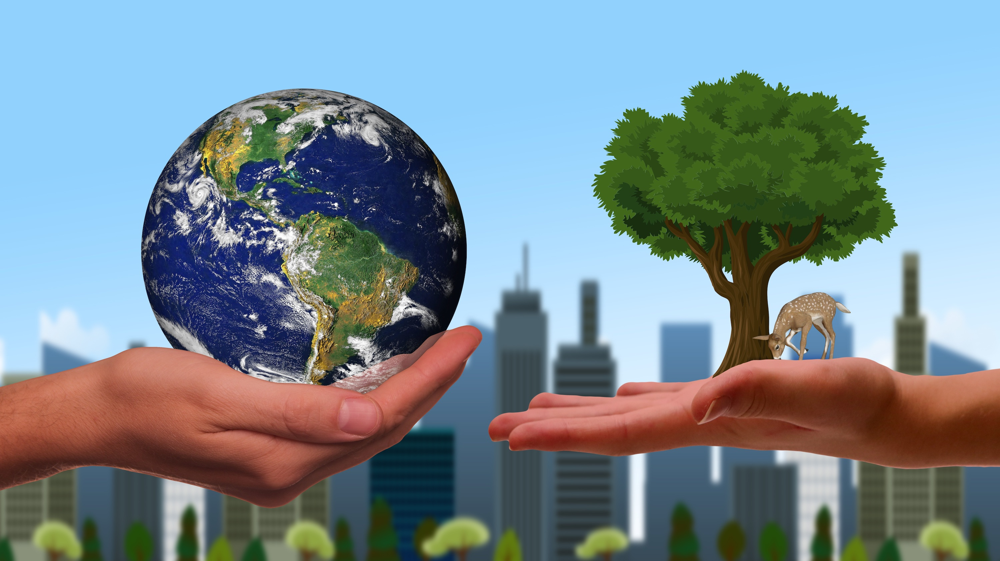

# [Volver al índice general](/README.md)

---

"La sostenibilidad es un concepto que busca satisfascer las necesidades del presente sin compreometer la capacidad de las generaciones futuras para satisfacer las suyas"

---
